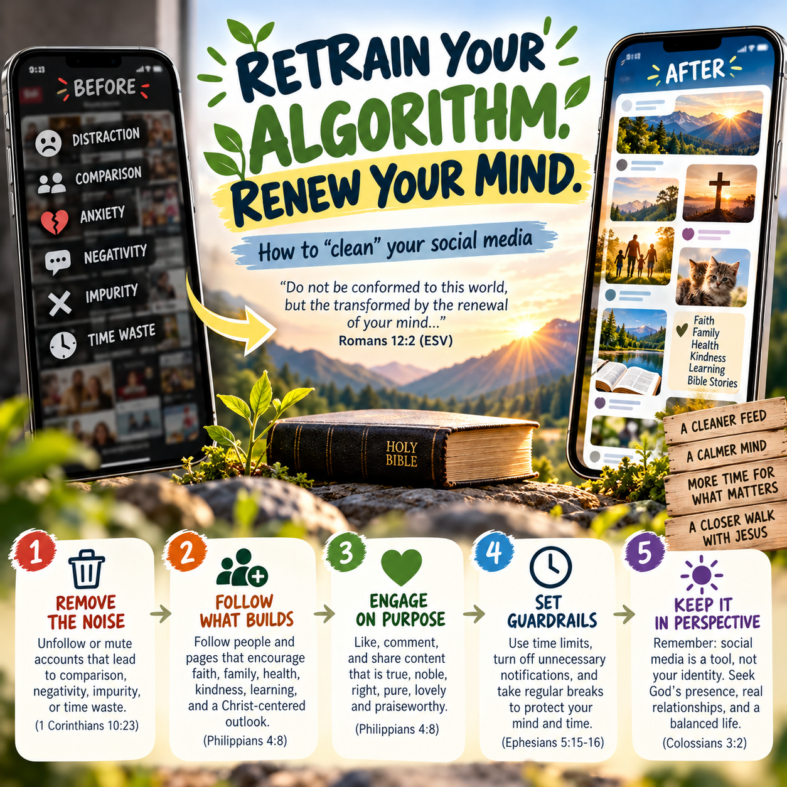

# Retrain Your Algorithm. Renew Your Mind.

**A Christian guide to "cleaning" your social media feeds, step by step, with pictures.**

> "Do not be conformed to this world, but be transformed by the renewal of your mind, that by testing you may discern what is the will of God, what is good and acceptable and perfect."
> — Romans 12:2

Social media apps learn from everything you do: what you watch, how long you pause, what you tap, and who you follow. Then they feed you more of it. Over time, **your feed is shaping your mind.**

The good news is that you can **retrain** your feed. This guide pairs biblical principles with the exact buttons to press on each major platform, so you can choose on purpose what shapes your heart.

> "And we all, with unveiled face, beholding the glory of the Lord, are being transformed into the same image." — 2 Corinthians 3:18

**Start here → [A Biblical Foundation for Your Feed](PRINCIPLES.md)** has seven principles from Scripture, a 7-day Feed Renewal plan, small-group questions, and a prayer.

## Pick your platform

| Platform | What you'll do |
|---|---|
| [][youtube] | Clear or pause watch history, "Not interested", "Don't recommend channel", unsubscribe, set break reminders |
| [][instagram] | Mute or unfollow, "Not interested", reset suggested content, sensitive content, daily limit |
| [][facebook] | "Not interested", snooze, unfollow, feed preferences, time reminders |
| [][tiktok] | "Not interested", refresh your For You feed, filter keywords, screen time limits |

[youtube]: guides/youtube.md
[instagram]: guides/instagram.md
[facebook]: guides/facebook.md
[tiktok]: guides/tiktok.md

## The 5 steps (on every platform)

### 1. Remove the noise
Unfollow or mute accounts that lead to comparison, negativity, impurity, or wasted time.
> "'All things are lawful,' but not all things are helpful. 'All things are lawful,' but not all things build up." — 1 Corinthians 10:23

### 2. Follow what builds
Follow people and pages that encourage faith, family, health, kindness, learning, and a Christ-centered outlook.
> "Whoever walks with the wise becomes wise." — Proverbs 13:20

### 3. Engage on purpose
Like, comment on, share, and *watch to the end* the content that is true, honorable, pure, and lovely. The algorithm counts every one of those as a vote.
> "Whatever is true, whatever is honorable, whatever is just, whatever is pure, whatever is lovely, whatever is commendable… think about these things." — Philippians 4:8

### 4. Set guardrails
Use time limits, turn off notifications you don't need, take regular breaks, and set aside a weekly digital Sabbath to protect your mind and your time.
> "Look carefully then how you walk, not as unwise but as wise, making the best use of the time, because the days are evil." — Ephesians 5:15–16

### 5. Keep it in perspective
Social media is a tool, not your identity. Seek God's presence, real relationships, and a balanced life.
> "Set your minds on things that are above, not on things that are on earth." — Colossians 3:2

## A 30-minute cleanup checklist

- [ ] **Pray first.** Ask God to show you what to keep and what to let go (Psalm 139:23–24).
- [ ] **Clear or reset** your history and recommendations (YouTube history, Instagram "Reset suggested content", TikTok "Refresh your For You feed")
- [ ] **Unfollow or mute** 10 accounts that don't build you up
- [ ] **Follow** 5 accounts that do
- [ ] **Tap "Not interested"** on every unwanted recommendation for the next week. Don't just scroll past it.
- [ ] **Add filtered words** for topics you want to avoid (Instagram Hidden Words, TikTok Filter keywords)
- [ ] **Set a daily time limit** and bedtime reminders on each app
- [ ] **Turn off** non-essential notifications
- [ ] **Plan a digital Sabbath**, a weekly sunset-to-sunset break from feeds (Exodus 20:8)

> **How long does it take?** Most feeds start to shift within a few days of consistent signals. A reset gives you a clean slate, but what you *keep* doing afterward is what trains the feed. Scrolling past something slowly still counts as interest. Renewing the mind works the same way: it's a daily walk, not a one-time event.

Want to go deeper? Try the **[7-day Feed Renewal plan](PRINCIPLES.md#a-7-day-feed-renewal-plan)**.

## About the pictures

The YouTube guide uses **real screenshots** for most steps. The other guides currently use **annotated illustrations** (in `images/`) that show where to tap. The red numbered circles match the numbered steps in the text. Apps change their menus often, so your screen may look a little different.

Want real screenshots instead? See **[SCREENSHOTS.md](SCREENSHOTS.md)** for the shot list and how to swap them in.

## Official help pages

These guides are a friendly summary. If a menu has moved, the official help pages have the current steps:

- YouTube: [Manage your recommendations](https://support.google.com/youtube/answer/6342839) · [Watch history](https://support.google.com/youtube/answer/95725)
- Instagram: [Reset suggested content](https://help.instagram.com/556617736965724/) · [Mute](https://help.instagram.com/469042960409432) · [Sensitive Content Control](https://help.instagram.com/1055538028699165)
- Facebook: [Control what you see in Feed](https://www.facebook.com/help/964154640320617/) · [Snooze](https://www.facebook.com/help/mobile-basic/538433456491590) · [Unfollow](https://www.facebook.com/help/190078864497547)
- TikTok: [How TikTok recommends content](https://support.tiktok.com/en/using-tiktok/exploring-videos/how-tiktok-recommends-content)

*Last reviewed: October 2026.*

Scripture quotations are from the ESV® Bible (The Holy Bible, English Standard Version®), © 2001 by Crossway, a publishing ministry of Good News Publishers. Used by permission. All rights reserved.
