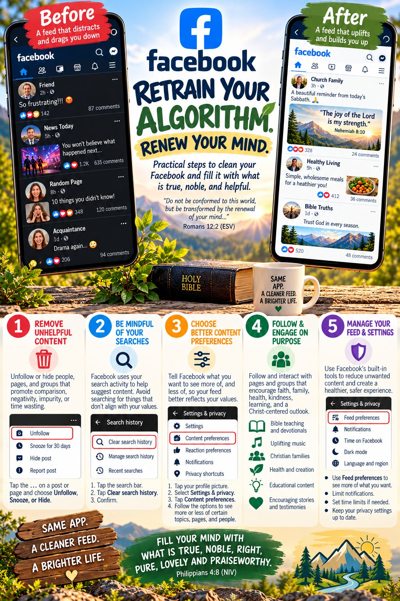
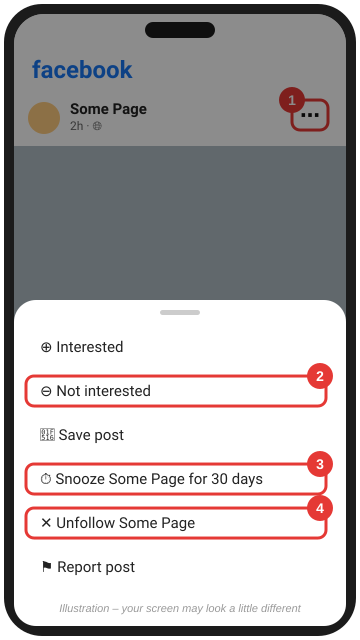
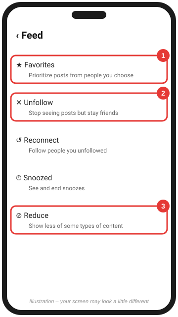
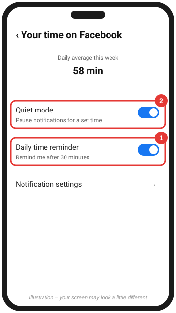

# Clean your Facebook feed

[← Back to all platforms](../README.md)

> 📖 "Let every person be quick to hear, slow to speak, slow to anger; for the anger of man does not produce the righteousness of God." — James 1:19–20

Facebook is where friends, family, church, and news all mix together, and where arguments break out most easily. The goal isn't to cut people off. It's to keep loving them without letting outrage and gossip fill your mind.

Facebook gives you three tools for any person, Page, or group: **Not interested** (show me less like this), **Snooze** (hide for 30 days), and **Unfollow** (hide for good, but stay friends).

*Same app, a cleaner feed, a brighter life.* The infographic gives the big picture. Facebook moves its menus around often, so follow the numbered steps below for the current buttons.

---

## 1. Use the post menu: Not interested, Snooze, or Unfollow

> 📖 "For lack of wood the fire goes out, and where there is no whisperer, quarreling ceases." — Proverbs 26:20
>
> *Unfollowing someone isn't unloving. You stay connected, and you can still pray for them, call them, and see them in person. You just stop feeding the fire.*

1. Tap the **⋯** at the top right of any post.
2. Pick the right tool:
   - **Not interested**: shows you less content like this post.
   - **Snooze [name] for 30 days**: a break without unfriending. Good for a heated election season.
   - **Unfollow [name]**: you stay friends or keep following the Page, but their posts stop appearing in your feed. They are not notified.

📷 **See real screenshots:** [Android Police: Snooze and Unfollow (May 2024)](https://www.androidpolice.com/how-to-unfollow-someone-on-facebook/)

 

---

## 2. Review your Feed preferences all at once

> 📖 "And let us consider how to stir up one another to love and good works, not neglecting to meet together, as is the habit of some, but encouraging one another." — Hebrews 10:24–25
>
> *Use **Favorites** to put your church, your family, and encouraging friends at the top of your feed.*

1. Tap **☰ Menu** → **⚙ Settings & privacy** → **Settings**.
2. Under **Preferences**, tap **Feed**.
3. Work through the list:
   - **Favorites**: pick up to 30 people and Pages to see *first*. This is the "follow what builds" step.
   - **Unfollow**: scroll a list of everyone you follow and unfollow them in bulk.
   - **Reconnect**: undo an unfollow.
   - **Snoozed**: see or end active snoozes.
   - **Reduce** *(where available)*: show less of certain kinds of content.
4. Back in **Settings**, open **Content preferences** *(where available)* to tell Facebook what you want to see more and less of.

**Be mindful of your searches.** Facebook uses what you search for to suggest content. To clear old searches, either:

- tap the **search bar** and choose **Clear search history** (or **See all** → **Clear searches**), or
- tap **☰ Menu** → **⚙ Settings & privacy** → **Activity log** → **Search history** → **Clear searches**.

📷 **See real screenshots:** [Android Police (May 2024)](https://www.androidpolice.com/how-to-unfollow-someone-on-facebook/) · [How-To Geek (Aug 2024)](https://www.howtogeek.com/how-to-clean-up-your-facebook-feed/)

 

---

## 3. Set guardrails

> 📖 "Be still, and know that I am God." — Psalm 46:10
>
> *Quiet mode is a simple way to make room for stillness, family time, and Sabbath rest.*

1. Tap **☰ Menu** → **⚙ Settings & privacy** → **Settings**.
2. Under **Preferences**, tap **Your time on Facebook**. *(Some versions list it directly under Settings & privacy.)*
3. Turn on a **Daily time reminder**.
4. Set up **Quiet mode** to pause notifications during focused or family time.

Then go to **Settings → Notifications** and turn off categories you don't need, such as *Reminders*, *Suggestions*, and *Marketplace*.

📷 **See real screenshots:** [MakeUseOf: daily time reminder (2022, older layout)](https://www.makeuseof.com/how-to-use-facebook-daily-time-reminder/)

 

---

### Groups and Pages

> 📖 "Make no friendship with a man given to anger, nor go with a wrathful man, lest you learn his ways and entangle yourself in a snare." — Proverbs 22:24–25

Leave groups that mostly produce arguments or gossip: open the group → **Joined ⌄** → **Leave group**. To stay in a group quietly, choose **Unfollow group** instead.

### Posting and commenting

> 📖 "Let no corrupting talk come out of your mouths, but only such as is good for building up, as fits the occasion, that it may give grace to those who hear." — Ephesians 4:29

Before you post or comment, ask: *Is it true? Is it kind? Does it build up? Would I say it face to face?*

### A prayer for this step

> *Lord, let my speech always be gracious, seasoned with salt (Colossians 4:6). Help me be a peacemaker online and off. Amen.*

**Go deeper:** [A Biblical Foundation for Your Feed](../PRINCIPLES.md)

**Official help:** [Control what you see in Feed](https://www.facebook.com/help/964154640320617/) · [Hide a post](https://www.facebook.com/help/268028706671439) · [Snooze](https://www.facebook.com/help/mobile-basic/538433456491590) · [Unfollow](https://www.facebook.com/help/190078864497547) · [Content preferences](https://www.facebook.com/help/371675846332829)

Scripture quotations are from the ESV® Bible (The Holy Bible, English Standard Version®), © 2001 by Crossway, a publishing ministry of Good News Publishers. Used by permission. All rights reserved.
