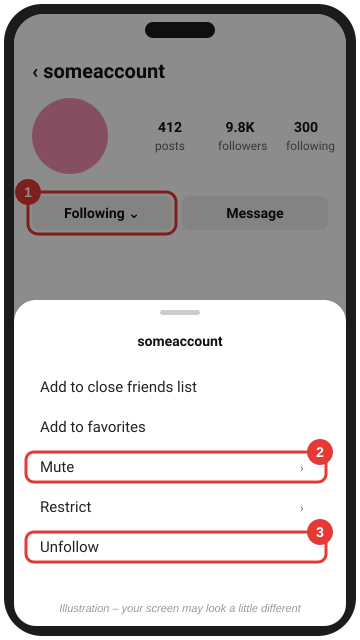
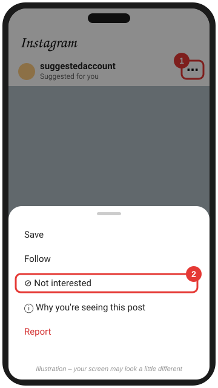
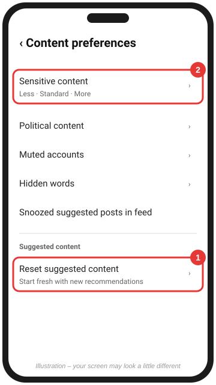
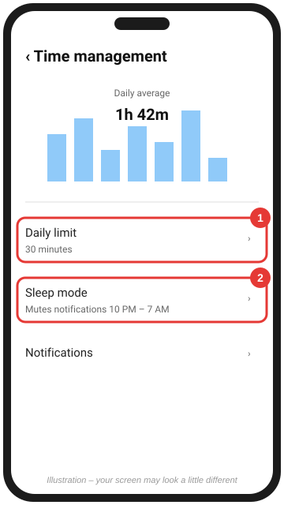

# Clean your Instagram feed

[← Back to all platforms](../README.md)

> 📖 "But when they measure themselves by one another and compare themselves with one another, they are without understanding." — 2 Corinthians 10:12

Instagram is built around images, so it's the app where **comparison** hits hardest. Remember that your worth isn't measured in likes: *"we are his workmanship, created in Christ Jesus for good works"* (Ephesians 2:10).

Instagram shows you posts from accounts you follow plus **suggested** posts and Reels picked from what you engage with. Clean up who you follow, then reset and steer the suggestions.

*Same app, a cleaner feed, a brighter life.* The infographic gives the big picture. Instagram moves its menus around often, so follow the numbered steps below for the current buttons.

---

## 1. Mute or unfollow accounts

> 📖 "Let us also lay aside every weight, and sin which clings so closely, and let us run with endurance the race that is set before us." — Hebrews 12:1
>
> *Some accounts aren't sinful, just heavy. If an account regularly leaves you envious, discouraged, or tempted, it's a weight you're free to lay aside.*

1. Go to the account's profile.
2. Tap **Following ⌄**.
3. **Mute**: hides their posts, stories, and/or notes from your feed without unfollowing. Nobody is notified. This is good for relatives or coworkers.
4. **Unfollow**: removes them from your feed entirely.

**Faster cleanup:** go to *your* profile, tap **Following**, and use the categories Instagram offers there (such as *Least interacted with*) to unfollow many accounts in one sitting.

📷 **See real screenshots:** [How-To Geek: unfollow (Aug 2024)](https://www.howtogeek.com/how-to-clean-up-your-instagram-feed/) · [How-To Geek: mute (2020, older layout)](https://www.howtogeek.com/672555/how-to-mute-someone-on-instagram/)

 

---

## 2. Tell Instagram "Not interested"

> 📖 "I will not set before my eyes anything that is worthless." — Psalm 101:3

On any **suggested** post or Reel (it says *Suggested for you*), or in **Explore**:

1. Tap the **⋯** above the post (on Reels, tap the **⋯** at the bottom right).
2. Tap **Not interested**.

You can also tap **Snooze all suggested posts in feed for 30 days**, and you can hide suggestions that contain specific words.

📷 **See real screenshots:** [Make Tech Easier (May 2025)](https://maketecheasier.com/turn-off-suggested-posts-instagram/)

 

---

## 3. Reset suggested content and turn sensitive content down

> 📖 "The eye is the lamp of the body. So, if your eye is healthy, your whole body will be full of light." — Matthew 6:22
>
> 📖 "The steadfast love of the LORD never ceases; his mercies never come to an end; they are new every morning." — Lamentations 3:22–23
>
> *A reset is a fresh start. Turning sensitive content to "Less" is a way of making "a covenant with my eyes" (Job 31:1).*

1. Go to your profile and tap **☰** (top right) to open **Settings and activity**.
2. Tap **Content preferences**.
3. Tap **Reset suggested content** and follow the prompts. At the end, Instagram offers to show you the accounts you follow so you can unfollow more of them at the same time. *(Phone app only; this isn't on the computer.)*
4. Tap **Sensitive content** and choose **Less**.

**Also in Settings and activity:**

- **Hidden words**: hide comments and message requests containing words or emojis you choose. Turn on the filters and add your own words.
- **Muted accounts**: review who you've muted.
- **Clear your search history (if needed)**: tap **Your activity** → **Recent searches** (called *Search history* in some versions) → **Clear all**. Old searches stop shaping your suggestions.

📷 **See real screenshots:** [Make Tech Easier: reset (Jul 2025)](https://maketecheasier.com/reset-instagram-algorithm/) · [How-To Geek: sensitive content (May 2024)](https://www.howtogeek.com/my-instagram-explore-page-was-a-useless-mess-until-i-did-these-6-things/)

 

---

## 4. Set guardrails

> 📖 "It is in vain that you rise up early and go late to rest, eating the bread of anxious toil; for he gives to his beloved sleep." — Psalm 127:2
>
> *Sleep mode and a daily limit protect two gifts from God: your rest and your time.*

1. In **Settings and activity**, tap **Time management**.
2. Set a **Daily limit** (e.g., 30 minutes).
3. Turn on **Sleep mode** to mute notifications overnight.

Then go to **Settings and activity → Notifications** and turn off anything you don't need, such as *Suggested content*, *Reels*, and *Live*.

📷 **See real screenshots:** [Android Authority: quiet mode (Apr 2025)](https://www.androidauthority.com/turn-quiet-mode-on-off-instagram-3383475/). We couldn't find current screenshots of the Daily limit screen.

 

---

### Follow what builds

> 📖 "Whatever is true, whatever is honorable, whatever is just, whatever is pure, whatever is lovely, whatever is commendable… think about these things." — Philippians 4:8

After the cleanup, **follow 5–10 accounts** that encourage you, and *like, save, and share* their posts. Saves and shares tell Instagram what you want more of. Ideas: Bible-reading plans, Christian music, creation and nature photography, healthy recipes, missions, and your local church.

### A prayer for this step

> *Father, free me from comparing myself with others. Remind me that my life is hidden with Christ in You (Colossians 3:3). Amen.*

**Go deeper:** [A Biblical Foundation for Your Feed](../PRINCIPLES.md)

**Official help:** [Reset suggested content](https://help.instagram.com/556617736965724/) · [Hide suggested posts](https://help.instagram.com/423267105807548/) · [Mute someone](https://help.instagram.com/469042960409432) · [Sensitive Content Control](https://help.instagram.com/1055538028699165)

Scripture quotations are from the ESV® Bible (The Holy Bible, English Standard Version®), © 2001 by Crossway, a publishing ministry of Good News Publishers. Used by permission. All rights reserved.
