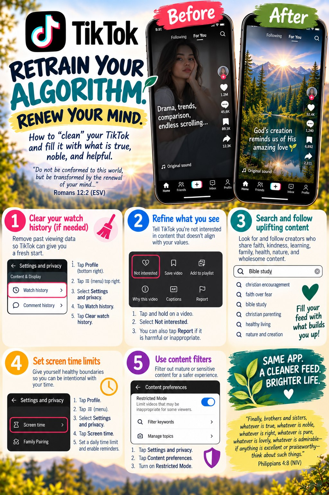
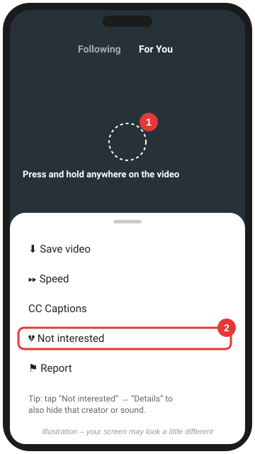
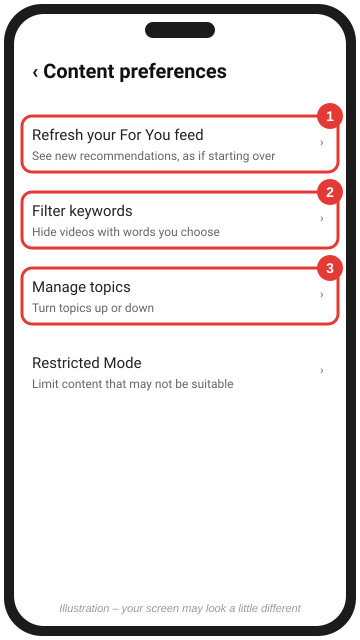
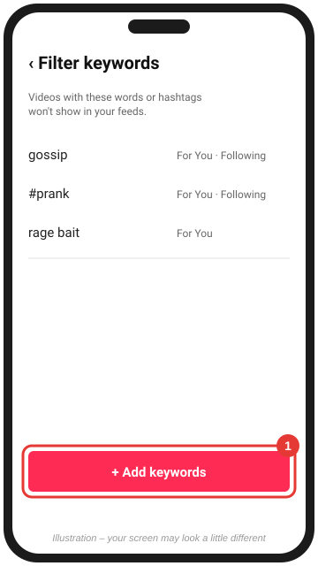
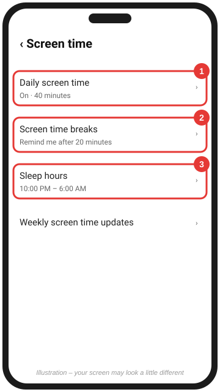

# Clean your TikTok feed

[← Back to all platforms](../README.md)

> 📖 "'All things are lawful for me,' but not all things are helpful. 'All things are lawful for me,' but I will not be dominated by anything." — 1 Corinthians 6:12

Short, endless videos are designed to keep you swiping. If "five minutes" regularly turns into an hour, the app is in charge rather than you.

TikTok's **For You** feed learns very fast, mostly from how long you watch, rewatches, likes, and shares. That means it can also be **retrained fast**.

*Same app, a cleaner feed, a brighter life.* The infographic gives the big picture. TikTok moves its menus around often, so follow the numbered steps below for the current buttons.

---

## 1. Long-press → "Not interested"

> 📖 "Test everything; hold fast what is good." — 1 Thessalonians 5:21
>
> *Each video is a small choice. Test it, keep the good, and tell the app "no" to the rest.*

1. When an unwanted video plays, **press and hold** anywhere on it.
2. Tap **Not interested**.
3. *(Optional)* Tap **Details** to also hide videos from **that creator** or with **that sound**.

Swipe away fast. Even 2–3 seconds of watching counts as interest.

📷 **See real screenshots:** [Make Tech Easier (Jun 2025)](https://www.maketecheasier.com/customize-tiktok-for-you-page/) · [Guiding Tech (Aug 2024)](https://www.guidingtech.com/how-to-reset-tiktok-for-you-feed/)

 

---

## 2. Refresh your For You feed, filter keywords, and manage topics

> 📖 "Remember not the former things, nor consider the things of old. Behold, I am doing a new thing." — Isaiah 43:18–19

1. Go to **Profile** → **☰** (top right) → **Settings and privacy**.
2. Tap **Content preferences**.
3. **Refresh your For You feed**: starts your recommendations over, as if you just joined. Expect popular, general videos for a little while as TikTok recalibrates.
4. **Filter keywords**: see step 3 below.
5. **Manage topics**: turn topics you want more of up, and others down.
6. *(Optional, good for families)* Turn on **Restricted Mode**.

**Clear your watch history (if needed).** In **Settings and privacy**, find **Watch history**. Depending on your version, it's under *Activity center* or *Content & Display*. Then select and clear the videos. This removes the list of what you've watched. **Refresh your For You feed** (above) is still the stronger reset for recommendations.

📷 **See real screenshots:** [MakeUseOf: refresh your feed (Mar 2024)](https://www.makeuseof.com/how-to-reset-tiktok-for-you-page/)

 

---

## 3. Filter out keywords and hashtags

> 📖 "Keep your heart with all vigilance, for from it flow the springs of life." — Proverbs 4:23
>
> *Keyword filters work like a gatekeeper: decide ahead of time what won't come in.*

1. In **Content preferences**, tap **Filter keywords**.
2. Tap **Add keywords**.
3. Type a word or hashtag (e.g., `gossip`, `#prank`) and choose which feeds to filter: **For You**, **Following**, and others where offered.
4. Where available, let TikTok also filter **similar words**.

📷 **See real screenshots:** [Make Tech Easier (Jun 2025)](https://www.maketecheasier.com/customize-tiktok-for-you-page/) · [MakeUseOf (May 2024)](https://www.makeuseof.com/best-ways-to-filter-out-tiktok-content/)

 

---

## 4. Set guardrails

> 📖 "So teach us to number our days that we may get a heart of wisdom." — Psalm 90:12
>
> *A daily limit isn't a punishment. It's stewardship of the hours God has given you.*

1. In **Settings and privacy**, tap **Screen time**.
2. Turn on **Daily screen time** and pick a limit.
3. Turn on **Screen time breaks** so TikTok reminds you to step away.
4. Set **Sleep hours** to mute notifications and get a wind-down reminder.

Families: **Family Pairing** (in Settings and privacy) lets a parent set these for a teen's account.

📷 **See real screenshots:** [Techloy (Dec 2024)](https://www.techloy.com/how-to-set-daily-screen-time-on-tiktok/)

 

---

### Clean up who you follow

> 📖 "Do not be deceived: 'Bad company ruins good morals.'" — 1 Corinthians 15:33

**Profile** → **Following** → tap the **Following** button next to an account to unfollow. Then search for and follow a few creators who build you up, and watch their videos to the end.

### A prayer for this step

> *Jesus, You are my rest. When I reach for my phone out of habit, turn my heart to You instead. Teach me to be still (Psalm 46:10). Amen.*

**Go deeper:** [A Biblical Foundation for Your Feed](../PRINCIPLES.md)

**Official help:** [How TikTok recommends content](https://support.tiktok.com/en/using-tiktok/exploring-videos/how-tiktok-recommends-content) · [For You feed](https://support.tiktok.com/en/getting-started/for-you/for-you)

Scripture quotations are from the ESV® Bible (The Holy Bible, English Standard Version®), © 2001 by Crossway, a publishing ministry of Good News Publishers. Used by permission. All rights reserved.
