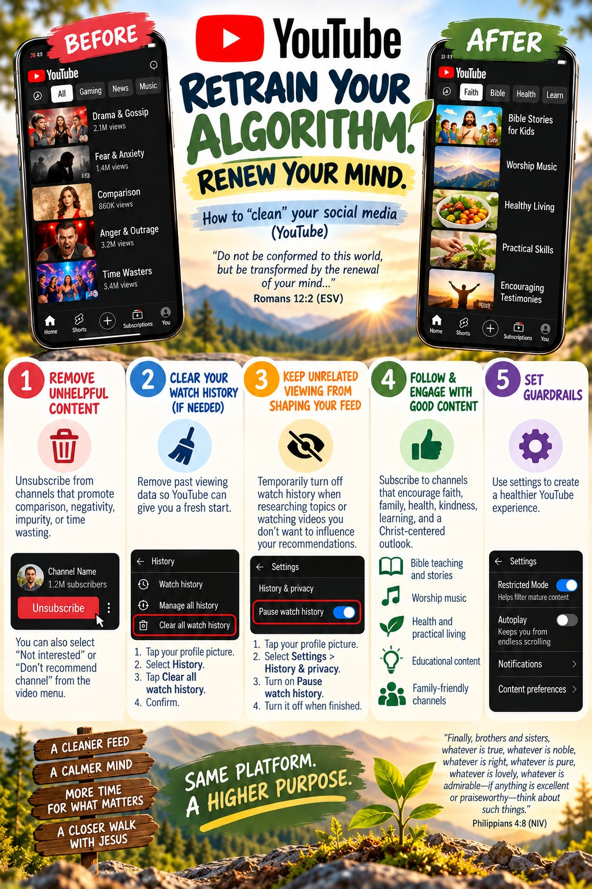
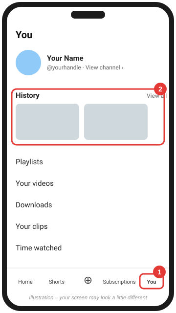
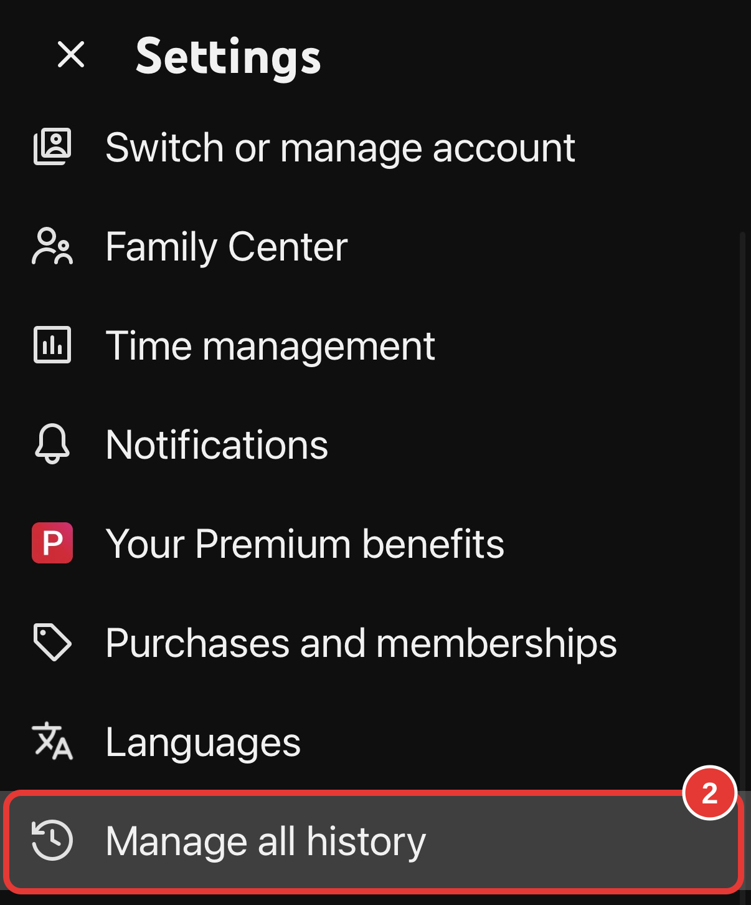
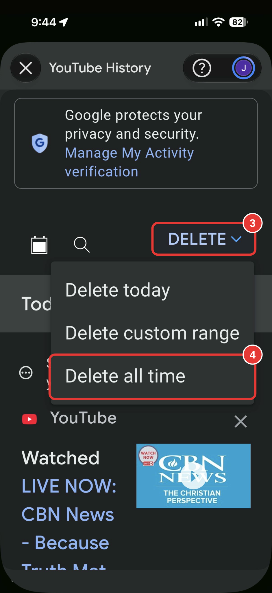
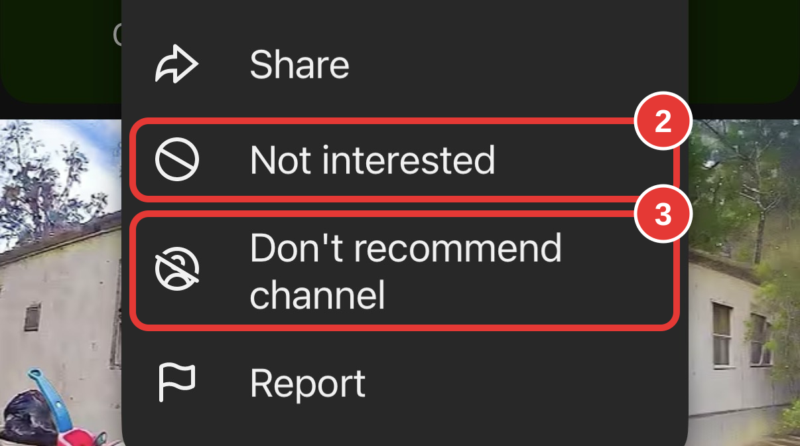
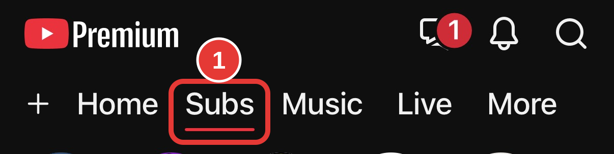
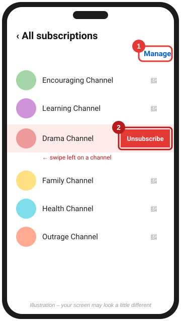
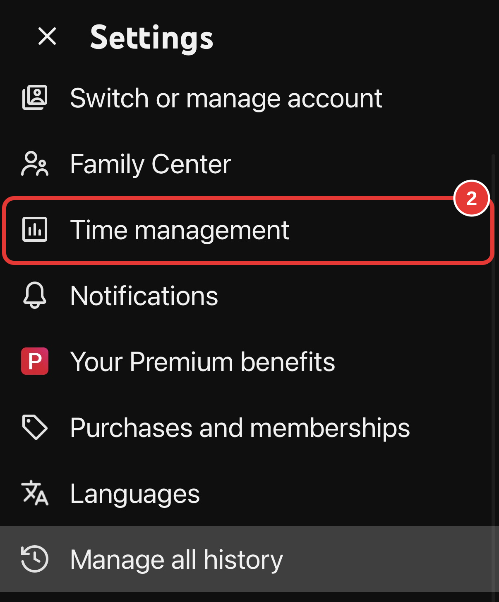
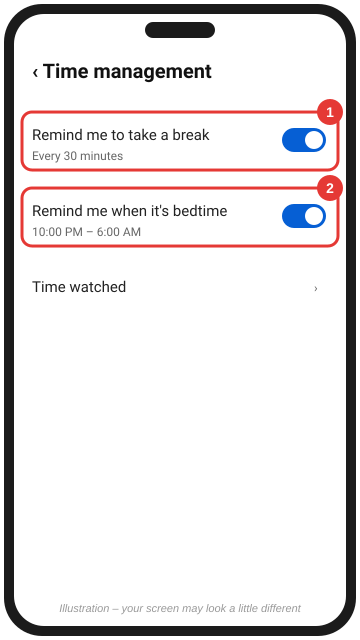
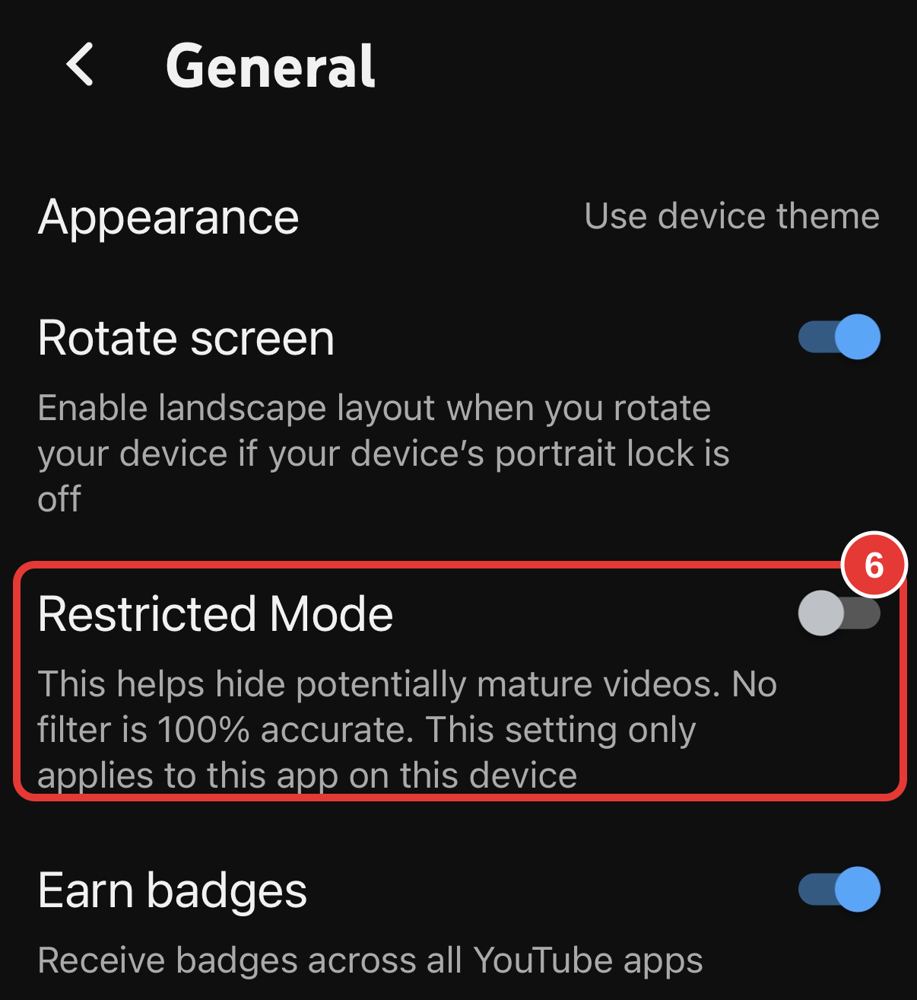

# Clean your YouTube feed

[← Back to all platforms](../README.md)

> 📖 "So teach us to number our days that we may get a heart of wisdom." — Psalm 90:12

YouTube recommends videos mostly from your **watch history**, your **search history**, your **subscriptions**, and the feedback you give it ("Not interested"). Clean up all four.

*Same platform, a higher purpose.* The infographic gives the big picture. YouTube moves its menus around often, so follow the numbered steps below for the current buttons. For example, in the current iPhone app the history controls are under **Settings → Manage all history**, not "History & privacy."

---

## 1. Open your history

> 📖 "Search me, O God, and know my heart! Try me and know my thoughts! And see if there be any grievous way in me, and lead me in the way everlasting!" — Psalm 139:23–24
>
> *Before you delete anything, take an honest look. What has been filling your eyes and mind? Ask God to show you.*

**Phone (YouTube app)**

1. Tap **You** in the bottom-right corner. *(In newer layouts with tabs across the top, tap your **profile picture** instead.)*
2. Next to **History**, tap **View all**.

**Computer (youtube.com)**

- In the left menu, click **History**. You can also go straight to [youtube.com/feed/history](https://www.youtube.com/feed/history).

📷 **More screenshots:** [MakeUseOf (Apr 2024)](https://www.makeuseof.com/how-to-view-manage-youtube-watch-history/)

 

---

## 2. Clear or pause your watch history

> 📖 "Remember not the former things, nor consider the things of old. Behold, I am doing a new thing." — Isaiah 43:18–19
>
> *Clearing your history gives the algorithm a clean slate, much as God's mercies are new every morning (Lamentations 3:22–23).*

 &nbsp; 

**Phone (YouTube app)**

1. Tap **You**, then the **⚙ Settings** gear at the top right.
2. Tap **Manage all history**.
3. Tap **DELETE ⌄**.
4. Tap **Delete all time** and confirm. *(Or choose **Delete today** or **Delete custom range** to clear just part of it.)*

YouTube stops using the deleted videos for recommendations. Your Home feed will look generic for a day or two while it relearns. Deleting history also clears your **search history** for the same period.

**Also on the YouTube History page:**

- Tap the **✕** next to a single video to delete just that one.
- Look for the setting to **turn off** (pause) saving YouTube history. Use it if you don't want *anything* you watch to shape recommendations, for example while researching a hard topic. Turn it back on later so good viewing can train your feed.
- Turn on **Auto-delete** (3, 18, or 36 months).

**Other ways in:** in the **History** screen, tap **⋮** for *Clear all watch history* and *Pause watch history*. On a computer, those buttons are in the right-hand panel of [youtube.com/feed/history](https://www.youtube.com/feed/history).

📷 **More screenshots:** [MakeUseOf (Apr 2024)](https://www.makeuseof.com/how-to-view-manage-youtube-watch-history/) · [Android Police (Sep 2023)](https://www.androidpolice.com/delete-youtube-search-watch-history/)

---

## 3. Say "Not interested" and "Don't recommend channel"

> 📖 "I will not set before my eyes anything that is worthless." — Psalm 101:3
>
> *Every "Not interested" is a small, practical way of living out this verse.*

Do this every time an unwanted video shows up on **Home** or **Up next**. Don't just scroll past it.

1. Tap the **⋮** next to the video title.
2. Tap **Not interested** to see fewer videos like this one. YouTube may ask *why*. Answering helps it learn faster.
3. Tap **Don't recommend channel** to stop seeing that channel completely.

This works for **Shorts** too: tap the **⋮** on a Short (or press and hold) and choose **Not interested** or **Don't recommend channel**.

📷 **More screenshots:** [Android Police (Jan 2026)](https://www.androidpolice.com/way-to-fix-youtube-recommendations/) · [How-To Geek (Mar 2024)](https://www.howtogeek.com/sick-of-bad-youtube-recommendations-heres-how-to-get-better-video-suggestions/)

 

---

## 4. Unsubscribe from channels that don't build you up

> 📖 "Whoever walks with the wise becomes wise, but the companion of fools will suffer harm." — Proverbs 13:20
>
> *Your subscriptions are the voices you've invited into your day. Choose them the way you'd choose friends.*

 &nbsp; 

1. Tap **Subs** in the tabs across the top. *(Older layouts: **Subscriptions** in the bottom bar.)*
2. Tap **All** (top right), then **Manage**.
3. Swipe left on a channel and tap **Unsubscribe**. On iPhone you can also open the channel and tap **Subscribed → Unsubscribe**.

While you're here, turn off the **🔔 bell** for channels you keep but don't need notifications from.

**Then follow what builds:** subscribe to a few channels that encourage faith, family, health, and learning, and *watch them all the way through*. Watch time is one of the strongest signals YouTube uses.

📷 **More screenshots:** [Android Police (Jan 2026)](https://www.androidpolice.com/way-to-fix-youtube-recommendations/) · [How-To Geek (2020, older layout)](https://www.howtogeek.com/677781/how-to-unsubscribe-from-a-youtube-channel/)

---

## 5. Set guardrails

> 📖 "Look carefully then how you walk, not as unwise but as wise, making the best use of the time, because the days are evil." — Ephesians 5:15–16
>
> *"Just one more video" can quietly spend an evening. Break and bedtime reminders help you keep your time for what matters most.*

 &nbsp; 

1. Tap **You**, then the **⚙ Settings** gear at the top right.
2. Tap **Time management**. *(Older app versions put these reminders under **General**.)*
3. Turn on **Remind me to take a break** and pick a time (e.g., every 30 minutes).
4. Turn on **Remind me when it's bedtime** and set your hours.

**Restricted Mode** *(optional, good for families)*

5. Back in **Settings**, tap **General**.
6. Turn on **Restricted Mode**. It hides potentially mature videos. No filter is 100% accurate, and it applies only to the YouTube app on *this* device, so turn it on for each phone, tablet, and TV.

Also in **Settings**:

- **Notifications**: turn off what you don't need.
- **Family Center**: supervise a child's or teen's account.

 

📷 **More screenshots:** [How-To Geek (Dec 2023, shows the older General location)](https://www.howtogeek.com/features-to-stop-watching-youtube/)

---

### Did it work?

Give it **3–7 days** of consistent signals. If Home still shows the old stuff, repeat step 3 on every unwanted video. Each "Not interested" is a direct instruction to the algorithm.

### A prayer for this step

> *Lord, help me set before my eyes only what is good. Let the meditation of my heart be acceptable in Your sight (Psalm 19:14). Amen.*

**Go deeper:** [A Biblical Foundation for Your Feed](../PRINCIPLES.md)

**Official help:** [Manage your recommendations](https://support.google.com/youtube/answer/6342839) · [View, delete, or turn off watch history](https://support.google.com/youtube/answer/95725)

Scripture quotations are from the ESV® Bible (The Holy Bible, English Standard Version®), © 2001 by Crossway, a publishing ministry of Good News Publishers. Used by permission. All rights reserved.
